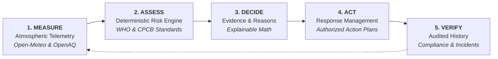

# 🌫️ AIRWISE — Comprehensive Project Plan & Architecture Blueprint

Welcome to the **AIRWISE** project repository! This document is a complete, beginner-friendly yet technically thorough guide designed to help any team member understand everything about AIRWISE from scratch: what it is, why it was built, the architecture, technologies used, data flow, API contracts, local development, and deployment.

---

## 📑 Table of Contents
1. [Project Overview & Problem Statement](#1-project-overview--problem-statement)
2. [The 5-Step Closed-Loop Lifecycle](#2-the-5-step-closed-loop-lifecycle)
3. [Technology Stack & Decisions](#3-technology-stack--decisions)
4. [System Architecture & Data Flow](#4-system-architecture--data-flow)
5. [Repository Structure (File-by-File Breakdown)](#5-repository-structure-file-by-file-breakdown)
6. [API Specification & Data Contracts](#6-api-specification--data-contracts)
7. [Deterministic Risk Engine Explained](#7-deterministic-risk-engine-explained)
8. [Database Schema (DynamoDB)](#8-database-schema-dynamodb)
9. [Step-by-Step Local Setup & Execution](#9-step-by-step-local-setup--execution)
10. [AWS Cloud Deployment Guide (SAM & Amplify)](#10-aws-cloud-deployment-guide-sam--amplify)
11. [Testing & Verification](#11-testing--verification)

---

## 1. Project Overview & Problem Statement

### The Problem
During peak pollution months in Delhi-NCR, atmospheric particulate matter (**PM₂.₅** and **PM₁₀**) frequently surges to hazardous levels. Campus administrators (schools, universities, corporate facilities) are faced with critical operational decisions:
- *Should outdoor sports and physical training be moved indoors?*
- *Should morning assemblies be canceled or shortened?*
- *Do facilities and outdoor maintenance workers require respirator masks and shift rotation?*

Historically, administrators either rely on generic AQI numbers from weather apps (which average distinct pollutants together and lack activity context) or make ad-hoc, uncoordinated decisions with no audit trail.

### The AIRWISE Solution
**AIRWISE** is an environmental decision-support system built for campus administrators across Delhi-NCR (Delhi, Noida, Ghaziabad). It connects live atmospheric forecast models with a **deterministic mathematical risk engine** to evaluate risks for specific campus activities, automatically generate role-based action plans, require human authorization, and maintain an immutable compliance audit trail.

---

## 2. The 5-Step Closed-Loop Lifecycle

AIRWISE operates on a strict, auditable 5-stage closed loop:



1. **MEASURE**: Retrieves hourly rolling atmospheric forecasts (ECMWF CAMS model via Open-Meteo) and ground-truth sensor measurements (OpenAQ v3).
2. **ASSESS**: Evaluates conditions against strict international (**WHO AQG 2021**) and national (**India CPCB NAAQS 2009**) standards for specific activities.
3. **DECIDE**: Generates transparent, auditable evidence showing valid sample counts, min/max/mean concentrations, and triggered rule reasons.
4. **ACT**: Creates action plans with assigned roles (*Sports Coordinator*, *Facilities Coordinator*, *Campus Administrator*) requiring formal sign-off.
5. **VERIFY**: Tracks task execution to completion with an immutable, append-only audit trail and community incident logging.

---

## 3. Technology Stack & Decisions

### Frontend (`app/`)
- **Framework**: **Next.js 16.4** with **Turbopack** and **React 19**
  - Modern, fast build times, static page generation (`next export`), and app router (`app/`).
- **Styling**: **Tailwind CSS v4** + `@tailwindcss/postcss`
  - Utility-first CSS with a custom Linear/Vercel-inspired deep navy/slate design system (`#070c14`, `#0b1322`, `#0f1a2e`) and muted teal accents (`#14b8a6`).
- **Data Visualization**: **Recharts 3**
  - Interactive multi-pollutant area charts, threshold reference lines, and frequency distribution bars.
- **Icons**: **Lucide React**
  - Clean, accessible iconography.
- **Date Handling**: **date-fns**
  - Robust ISO timestamp parsing and relative time formatting.

### Backend (`backend/`)
- **Runtime**: **Node.js 20.x ESM**
- **Serverless Architecture**: **AWS Lambda** via **AWS SAM (Serverless Application Model)**
- **Local Dev Server**: Standalone **Express 5** server (`backend/local.mjs`) mimicking DynamoDB in-memory with live Open-Meteo forecast fetching.
- **Persistence**: **Amazon DynamoDB** (Pay-Per-Request billing mode) with Global Secondary Indexes (GSIs).

---

## 4. System Architecture & Data Flow

```
 ┌────────────────────────────────────────────────────────────────────────────────────────┐
 │                              Frontend (Next.js 16 App)                                 │
 │  Port: 3000 | App Router | React 19 | Tailwind v4 | Recharts                           │
 │                                                                                        │
 │  ┌──────────────┐  ┌──────────────┐  ┌──────────────┐  ┌──────────────┐  ┌──────────┐  │
 │  │Command Center│  │ Air Intel    │  │  Assessment  │  │Response Ctr  │  │ History  │  │
 │  │    (`/`)     │  │  (`/air`)    │  │(`/assessment`)│ │(`/response`) │  │(`/history│  │
 │  └──────┬───────┘  └──────┬───────┘  └──────┬───────┘  └──────┬───────┘  └────┬─────┘  │
 │         └─────────────────┼─────────────────┼─────────────────┼───────────────┘        │
 │                           ▼                 ▼                 ▼                        │
 │               AppProvider State (`app/lib/context.tsx`) + API Client (`app/lib/api.ts`) │
 └───────────────────────────────────────────┬────────────────────────────────────────────┘
                                             │ HTTP JSON API (`NEXT_PUBLIC_API_URL`)
                                             ▼
 ┌────────────────────────────────────────────────────────────────────────────────────────┐
 │                      Backend Service (AWS SAM Lambda / Express Local)                  │
 │  Port: 3001 | AWS Lambda (Node.js 20 ESM) | DynamoDB Tables / In-Memory Shim           │
 │                                                                                        │
 │  ┌──────────────────────────────────────────────────────────────────────────────────┐  │
 │  │ HTTP Router (`backend/src/handler.mjs` & `backend/local.mjs`)                    │  │
 │  │  • GET  /health          • GET  /campuses        • GET  /air-quality             │  │
 │  │  • POST /assessments     • GET  /assessments     • POST /action-plans            │  │
 │  │  • PATCH /action-plans/:id (approve_plan, dismiss_plan, update_action)           │  │
 │  │  • POST /incidents       • GET  /incidents                                       │  │
 │  └───────────────────────────────┬──────────────────────────────────────────────────┘  │
 │                                  │                                                     │
 │                                  ▼                                                     │
 │  ┌──────────────────────────────────────────────────────────────────────────────────┐  │
 │  │ Deterministic Risk Engine (`backend/src/engine.mjs`)                             │  │
 │  │  • Evaluates: outdoor_sports, assembly, outdoor_work                             │  │
 │  │  • Rules: WHO 24h (PM2.5 > 15, PM10 > 45) | NAAQS 24h (PM2.5 > 60, PM10 > 100) │  │
 │  │  • Outputs: clear | review_required | action_recommended + evidence breakdown    │  │
 │  └───────────────────────────────┬──────────────────────────────────────────────────┘  │
 │                                  │                                                     │
 │         ┌────────────────────────┴────────────────────────┐                            │
 │         ▼                                                 ▼                            │
 │  ┌───────────────────────────────┐              ┌───────────────────────────────────┐  │
 │  │ External Telemetry Ingestion  │              │ Persistence Layer (DynamoDB)      │  │
 │  │ • Open-Meteo CAMS Forecast    │              │ • CampusTable                     │  │
 │  │ • OpenAQ Ground Observations  │              │ • AssessTable                     │  │
 │  │                               │              │ • PlanTable                       │  │
 │  │                               │              │ • IncidentTable                   │  │
 │  └───────────────────────────────┘              └───────────────────────────────────┘  │
 └────────────────────────────────────────────────────────────────────────────────────────┘
```

---

## 5. Repository Structure (File-by-File Breakdown)

```
airwise/
├── README.md                      # Quickstart documentation for the repository
├── PROJECT_PLAN.md                # Comprehensive technical guide & architecture doc
├── template.yaml                  # AWS SAM infrastructure definition (Lambda, DynamoDB, API GW)
├── amplify.yml                    # AWS Amplify Hosting build settings for Next.js frontend
├── .gitignore                     # Git ignore rules for node_modules, build artifacts, envs
│
├── app/                           # Next.js 16 Frontend Application
│   ├── app/                       # App Router Pages
│   │   ├── layout.tsx             # Root layout with AppProvider, Sidebar & TopBar
│   │   ├── globals.css            # Design system, CSS variables, custom scrollbars & theme
│   │   ├── page.tsx               # Screen 1: Command Center (Operational overview)
│   │   ├── air/page.tsx           # Screen 2: Air Intelligence (Detailed pollutant curves)
│   │   ├── assessment/page.tsx    # Screen 3: Campus Assessment (Activity risk workbench)
│   │   ├── response/page.tsx      # Screen 4: Response Centre (Plan authorization & tasks)
│   │   └── history/page.tsx       # Screen 5: Reports, Metrics & Incident Log
│   ├── components/                # Modular React UI Components
│   │   ├── layout/
│   │   │   ├── Sidebar.tsx        # Responsive navigation with badge counters & lifecycle helper
│   │   │   └── TopBar.tsx         # Health beacon, campus selector, refresh button, alerts drawer
│   │   ├── dashboard/
│   │   │   ├── CommandCenter.tsx  # Confidence gauge, quick actions & workflow pipeline
│   │   │   └── CampusComparison.tsx # Modal comparing Delhi, Noida, Ghaziabad side-by-side
│   │   ├── charts/
│   │   │   ├── ForecastChart.tsx  # Interactive AreaChart with 6h/12h/24h & WHO/CPCB lines
│   │   │   └── ThresholdTimeline.tsx # 24h hourly color matrix & best outdoor window finder
│   │   ├── assessment/
│   │   │   └── AssessmentCard.tsx # Explainable decision card with numerical evidence table
│   │   └── ui/
│   │       └── Card.tsx           # Reusable primitives (Card, StatCard, Badge, Button, Banner)
│   ├── lib/                       # Frontend Utilities & Context
│   │   ├── api.ts                 # Strongly-typed API client & error model
│   │   ├── context.tsx            # Global AppContext (campus, alerts, refresh, backend state)
│   │   └── utils.ts               # Formatting helpers, color configs, date utilities
│   ├── postcss.config.mjs         # PostCSS configuration enabling Tailwind CSS v4
│   ├── package.json               # Frontend dependencies & build scripts
│   └── tsconfig.json              # TypeScript configuration
│
└── backend/                       # Backend API & Risk Engine
    ├── src/
    │   ├── handler.mjs            # AWS Lambda API Gateway HTTP handler
    │   └── engine.mjs             # Deterministic mathematical risk engine (WHO & CPCB rules)
    ├── test/
    │   ├── engine.test.mjs        # Unit test suite for risk engine calculations
    │   └── integration.test.mjs   # 15-scenario end-to-end API integration test suite
    ├── local.mjs                  # Express local dev server with in-memory DynamoDB shim
    └── package.json               # Backend dependencies & test scripts
```

---

## 6. API Specification & Data Contracts

Base URL locally: `http://localhost:3001/api/v1`

### 1. Health Probe
- **`GET /health`**
- **Response `(200 OK)`**:
  ```json
  { "ok": true, "time": "2026-10-09T10:00:00Z", "version": "2.0.0", "store": "in-memory" }
  ```

### 2. List Campuses
- **`GET /campuses`**
- **Response `(200 OK)`**:
  ```json
  {
    "campuses": [
      {
        "campusId": "campus_delhi",
        "name": "Central Delhi Campus",
        "city": "New Delhi",
        "latitude": 28.6139,
        "longitude": 77.2090,
        "activityTypes": ["outdoor_sports", "assembly", "outdoor_work"]
      }
    ]
  }
  ```

### 3. Retrieve Air Quality
- **`GET /air-quality?campusId=campus_delhi`**
- **Response `(200 OK)`**:
  ```json
  {
    "campusId": "campus_delhi",
    "retrievedAt": "2026-10-09T10:00:00Z",
    "observations": [],
    "forecast": [
      {
        "time": "2026-10-09T11:00:00Z",
        "pollutant": "pm2_5",
        "value": 54.2,
        "unit": "µg/m³",
        "dataMode": "forecast",
        "provider": "Open-Meteo Air Quality (CAMS model)"
      }
    ],
    "modelledCurrent": {
      "time": "2026-10-09T10:00:00Z",
      "pm2_5": 54.2,
      "pm10": 132.8,
      "dataMode": "forecast"
    },
    "warnings": []
  }
  ```

### 4. Create Assessment
- **`POST /assessments`**
- **Request Body**:
  ```json
  { "campusId": "campus_delhi", "activity": "outdoor_sports" }
  ```
- **Response `(201 Created)`**:
  ```json
  {
    "assessmentId": "asmt_4ae28035",
    "campusId": "campus_delhi",
    "activity": "outdoor_sports",
    "createdAt": "2026-10-09T10:00:00Z",
    "dataMode": "forecast",
    "status": "action_recommended",
    "reasons": [
      { "code": "PM2_5_ABOVE_WHO", "message": "Forecast pm2_5 24h mean 57.1 µg/m³ exceeds WHO 2021 24h guideline (15)." },
      { "code": "PM10_ABOVE_NAAQS", "message": "Forecast pm10 24h mean 149.4 µg/m³ exceeds India CPCB 24h standard (100)." }
    ],
    "evidence": {
      "pm2_5": { "mean24h": 57.1, "max": 78.7, "hours": 24, "unit": "µg/m³", "provider": "Open-Meteo Air Quality (CAMS model)" }
    },
    "guidelineVersion": "WHO-AQG-2021 + India-CPCB-NAAQS-2009",
    "recommendedActions": [
      { "code": "REVIEW_OUTDOOR_ACTIVITY", "label": "Review / move outdoor sports session indoors", "owner": "Sports coordinator", "requiresApproval": true }
    ]
  }
  ```

### 5. Create Draft Action Plan
- **`POST /action-plans`**
- **Request Body**:
  ```json
  { "assessmentId": "asmt_4ae28035" }
  ```
- **Response `(201 Created)`**:
  ```json
  {
    "planId": "plan_dae7c8a9",
    "assessmentId": "asmt_4ae28035",
    "campusId": "campus_delhi",
    "status": "draft",
    "actions": [
      { "actionId": "act_1", "label": "Review / move outdoor sports session indoors", "owner": "Sports coordinator", "status": "pending", "completedAt": null }
    ],
    "audit": [
      { "at": "2026-10-09T10:00:00Z", "by": "system", "event": "Draft created from asmt_4ae28035 (action_recommended)" }
    ]
  }
  ```

### 6. Modify Action Plan (Approve / Dismiss / Update Task)
- **`PATCH /action-plans/:planId`**
- **Approve Plan**:
  ```json
  { "operation": "approve_plan", "actor": "Dr. Sharma" }
  ```
- **Dismiss Plan**:
  ```json
  { "operation": "dismiss_plan", "actor": "Dr. Sharma", "reason": "Event shifted indoors" }
  ```
- **Update Task Status**:
  ```json
  { "operation": "update_action", "actionId": "act_1", "status": "completed", "actor": "Sports coordinator" }
  ```

### 7. Community Incident Logging
- **`POST /incidents`**
- **Request Body**:
  ```json
  { "campusId": "campus_delhi", "incidentType": "smoke", "description": "Biomass burning near west boundary" }
  ```
- **Response `(201 Created)`**

---

## 7. Deterministic Risk Engine Explained

Located in [`backend/src/engine.mjs`](file:///Users/tanishkgupta/Downloads/airwise%202/backend/src/engine.mjs):
- **Zero LLM Hallucinations**: Risk math is 100% deterministic and reproducible.
- **24-Hour Rolling Mean**: Calculates the mathematical average across valid forecast hours:
  $$\mu = \frac{1}{N}\sum_{i=1}^N v_i \quad (N \ge 18 \text{ valid hourly sample points required})$$
- **Rule Hierarchy**:
  1. If valid sample hours $< 18 \implies$ `insufficient_data`
  2. If $\mu_{\text{PM2.5}} > 60$ or $\mu_{\text{PM10}} > 100 \implies$ `action_recommended` (Exceeds India CPCB 2009 Standard)
  3. If $\mu_{\text{PM2.5}} > 15$ or $\mu_{\text{PM10}} > 45 \implies$ `review_required` (Exceeds WHO 2021 Guideline)
  4. Otherwise $\implies$ `monitor` (Within standard screening thresholds)

---

## 8. Database Schema (DynamoDB)

Defined in [`template.yaml`](file:///Users/tanishkgupta/Downloads/airwise%202/template.yaml):

1. **`CampusTable`**:
   - Primary Key: `campusId (String, Partition Key)`
2. **`AssessTable`**:
   - Primary Key: `assessmentId (String, Partition Key)`
   - GSI: `campusId-createdAt-index` (PK: `campusId`, SK: `createdAt`)
3. **`PlanTable`**:
   - Primary Key: `planId (String, Partition Key)`
   - GSI: `campusId-createdAt-index` (PK: `campusId`, SK: `createdAt`)
4. **`IncidentTable`**:
   - Primary Key: `incidentId (String, Partition Key)`
   - GSI: `campusId-reportedAt-index` (PK: `campusId`, SK: `reportedAt`)

---

## 9. Step-by-Step Local Setup & Execution

### Prerequisites
- **Node.js**: v20.x or higher
- **npm**: v10.x or higher

### 1. Clone Repository & Setup
```bash
git clone https://github.com/Tanishk008/Airwise.git
cd Airwise
```

### 2. Start Backend Local Service
Open a terminal:
```bash
cd backend
npm install
node local.mjs
```
*Backend runs on `http://localhost:3001/api/v1` with in-memory persistence and live Open-Meteo atmospheric forecasts.*

### 3. Start Frontend Application
Open a second terminal:
```bash
cd app
npm install
npm run dev -- -p 3000
```
*Frontend runs on `http://localhost:3000`.*

---

## 10. AWS Cloud Deployment Guide (SAM & Amplify)

### Deploy Backend via AWS SAM
```bash
cd Airwise
sam build
sam deploy --guided
```
- Set `AllowedOrigin` to your Amplify domain.
- Once deployed, copy the **`ApiUrl`** output (e.g. `https://xyz.execute-api.ap-south-1.amazonaws.com`).

### Deploy Frontend via AWS Amplify
1. Connect this GitHub repository in the **AWS Amplify Console**.
2. Under **Environment Variables**, set:
   ```env
   NEXT_PUBLIC_API_URL=https://xyz.execute-api.ap-south-1.amazonaws.com
   ```
3. Amplify will automatically read [`amplify.yml`](file:///Users/tanishkgupta/Downloads/airwise%202/amplify.yml), build the Next.js static export (`npm run build`), and host the web app.

---

## 11. Testing & Verification

### Running All Automated Tests
```bash
# Backend Deterministic Engine & Full API Integration Test Suite
cd backend
npm run test:all

# Frontend TypeScript Type Check & Production Build Validation
cd ../app
npm run build
```

---

## 🤝 Team Contribution Guidelines
- Keep the risk engine deterministic in `backend/src/engine.mjs`.
- Never label forecast models as physical sensor readings.
- Use the typed client in `app/lib/api.ts` for all frontend API communications.
- Maintain the deep slate/navy palette (`globals.css`) for consistent UX.
