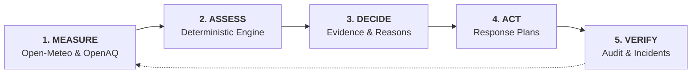

# 🌫️ AIRWISE — Air Quality Intelligence & Response System

> Closed-loop environmental decision-support system for Delhi-NCR campuses:  
> **MEASURE → ASSESS → DECIDE → ACT → VERIFY**

[](https://aws.amazon.com)
[-black)](https://nextjs.org)
[](https://tailwindcss.com)
[](https://www.typescriptlang.org/)
[](LICENSE)

📖 **For complete technical details, system design diagrams, file-by-file breakdowns, and architecture documentation, read [`PROJECT_PLAN.md`](./PROJECT_PLAN.md).**

---

## 🚀 Quick Start (Local Development)

### 1. Clone & Install Dependencies
```bash
git clone https://github.com/Tanishk008/Airwise.git
cd Airwise
```

### 2. Start Backend Service (Port 3001)
```bash
cd backend
npm install
node local.mjs
```
*API is live at `http://localhost:3001/api/v1/health` with in-memory persistence and live Open-Meteo atmospheric forecasts.*

### 3. Start Frontend Dashboard (Port 3000)
Open a new terminal window:
```bash
cd app
npm install
npm run dev -- -p 3000
```
*Open [http://localhost:3000](http://localhost:3000) in your browser.*

---

## 🔄 The 5-Step Operational Lifecycle



1. **MEASURE**: Retrieves hourly rolling atmospheric forecasts (ECMWF CAMS model via Open-Meteo) and ground-truth sensor measurements (OpenAQ v3).
2. **ASSESS**: Evaluates conditions against strict international (**WHO AQG 2021**) and national (**India CPCB NAAQS 2009**) standards for specific campus activities (`outdoor_sports`, `assembly`, `outdoor_work`).
3. **DECIDE**: Generates transparent, auditable decision evidence showing sample counts, min/max/mean concentrations, and triggered rule reasons without black-box scores.
4. **ACT**: Creates action plans with assigned roles (*Sports Coordinator*, *Facilities Coordinator*, *Campus Administrator*) requiring formal authorization.
5. **VERIFY**: Tracks task execution to completion with an immutable, append-only audit trail, operational metrics, community incident reporting, and JSON compliance export.

---

## 💻 Tech Stack

| Layer | Technology |
|---|---|
| **Frontend** | Next.js 16.4 (Turbopack, React 19), TypeScript, Tailwind CSS v4, Recharts, Framer Motion, Lucide Icons |
| **Hosting** | AWS Amplify Hosting (Static Export / CI/CD) |
| **API** | AWS API Gateway HTTP API / Express Local Dev Server |
| **Compute** | AWS Lambda (Node.js 20 ESM) |
| **Database** | Amazon DynamoDB (Pay-Per-Request, 4 tables with GSIs) |
| **Air Data** | Open-Meteo Air Quality API (ECMWF CAMS Forecast) + OpenAQ v3 (Station Sensors) |

---

## 📊 Dual Regulatory Thresholds

| Pollutant | WHO AQG 2021 (24h Mean) | India CPCB NAAQS 2009 (24h Mean) |
|---|---|---|
| **PM₂.₅** | 15 µg/m³ | 60 µg/m³ |
| **PM₁₀** | 45 µg/m³ | 100 µg/m³ |

*Source: `backend/src/engine.mjs`*

---

## 🧪 Testing & Validation

```bash
# Run backend engine tests & full 15-scenario API integration suite
cd backend
npm run test:all

# Run Next.js type check & production build validation
cd ../app
npm run build
```

---

## ☁️ AWS Cloud Deployment (SAM + Amplify)

### Deploy Backend with AWS SAM
```bash
sam build
sam deploy --guided
```
*Outputs the `ApiUrl` (e.g. `https://xyz.execute-api.ap-south-1.amazonaws.com`).*

### Deploy Frontend with AWS Amplify
1. Connect this GitHub repository in the **AWS Amplify Console**.
2. Add environment variable: `NEXT_PUBLIC_API_URL=<your-api-gateway-url>`.
3. Amplify reads `amplify.yml` and builds the static production bundle automatically.

---

## 📄 License
This project is licensed under the MIT License.
